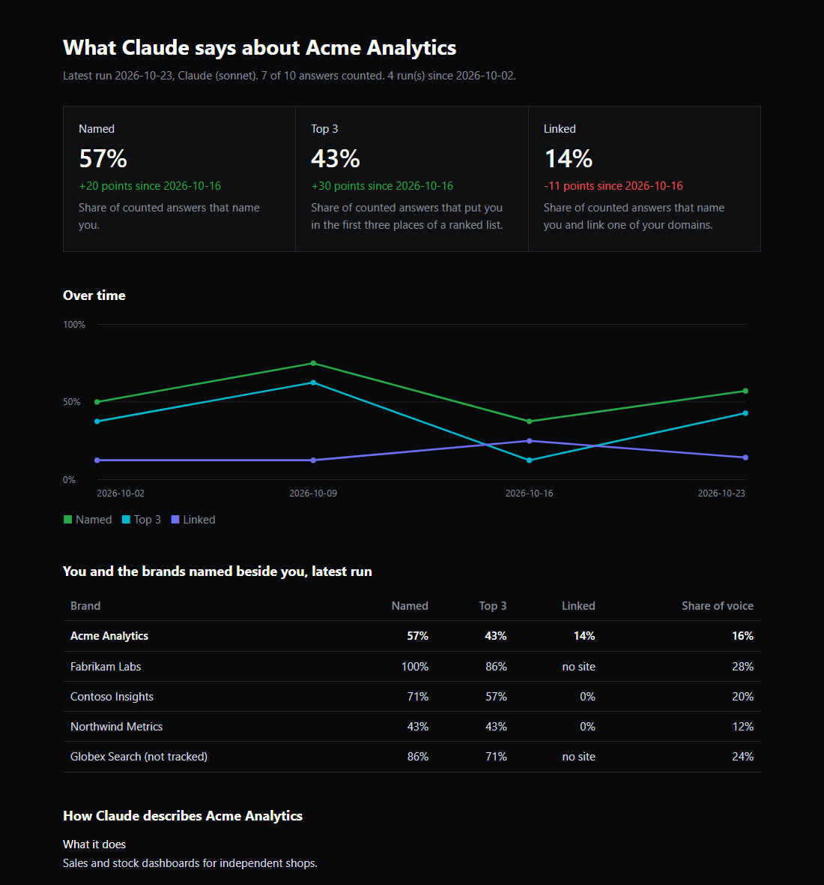

# Overheard Lite

**See what Claude or ChatGPT says about your brand, with the AI app you already pay for.**

Overheard Lite is the light version of [Overheard AI](../README.md). There's no app to install and no API key. You make a folder, open it in the Code tab of the Claude app or in Codex in the ChatGPT app, and paste one line. Your assistant sets it up with you, asks a handful of buyer questions on a schedule, saves every answer in the folder, and keeps a dashboard up to date. It counts brands the same way Overheard AI does.



## Install it

1. Make an empty folder with a plain name, such as `Overheard`.
2. Open it in the **Code** tab of the Claude app, or in **Codex** in the ChatGPT app.
3. Paste this:

```text
Set up Overheard Lite in this folder: https://github.com/TrellaceTeam/overheard-ai/tree/main/lite
```

Your assistant follows [INSTALL.md](INSTALL.md). It asks for your website, reads it, and proposes the whole setup in one message: your competitors, six buyer questions, how often to run, and what a run uses. Say yes or change anything. Setup takes about five minutes.

You need Python 3.9 or later, which most Macs have. On Windows, the assistant offers to install it.

## What a run does

1. It asks each buyer question in a fresh helper agent that gets only the question. The helper doesn't know your brand, your competitors or why it's being asked, and it can't see the other answers. It searches the web, answers, and saves its answer and sources as a file.
2. It asks one more helper what it knows about your brand.
3. Your assistant reads each answer into a short list of the brands it names, in order.
4. A script checks every file, counts the results and rebuilds `dashboard.html`.

By default each question is asked twice, so a run is 13 helpers. In our tests a run of 4 helpers took one to two minutes, so expect a few minutes. A run counts against your plan's usage limits like a long chat. Scheduled runs happen only while the app is open and your computer is awake. A run missed while the computer slept happens once when it wakes.

## What it measures

| Number | Share of answers that |
| --- | --- |
| Named | name your brand |
| Top 3 | put you in the first three places of a ranked list |
| Linked | name you and link one of your domains |

Share of voice divides a brand's mentions by every brand mention in the same answers. Questions that name your own brand are asked but never counted, and a question whose answers name no brand at all adds nothing. These are Overheard AI's rules, and the tests run the app's own scoring fixtures through this version.

The dashboard also shows how the assistant describes you, every answer in full, and the brands it names that you don't track yet.

## Lite or the app

| | Overheard Lite | Overheard AI |
| --- | --- | --- |
| Install | A folder and one pasted line | Node, git and npm |
| Pays with | Your Claude or ChatGPT plan's usage | API keys, or a plan in subscription mode |
| Assistants | The one your plan covers | ChatGPT, Claude and Gemini side by side |
| Schedule | Your app's scheduled tasks | Inside the running app |
| Dashboard | One page in the folder | Interactive, with filters |

To measure both Claude and ChatGPT with Lite, use one folder for each.

## Your data

Everything stays in the folder:

- `overheard.json` holds your setup.
- `runs/<date>/` holds each answer as a Markdown file, the brands read from it, and what the run asked.
- `dashboard.html` opens in any browser, works offline, and can be shared as a file.

Overheard Lite sends nothing of its own and uses no API key. Your app sends each session to Anthropic or OpenAI as it always does, and the helpers search the web.

## Limits

- It measures what the assistant says through its coding tool, with web search on. That's close to what people see in the Claude or ChatGPT chat apps, but not the same.
- Claude Code tells the model the email you signed in with. An email at your own company's domain can tilt answers toward you. A separate account with a neutral email avoids it. Both apps also tell the model the folder's path, the date and your operating system, and Codex adds your time zone.
- The assistant reads the brands out of each answer. The script checks every reading against the answer text and flags tracked brands it may have missed, but it can't catch everything.
- Plans have usage limits neither company publishes. A run that hits one retries once, then marks those answers failed, and the dashboard says so.
- We've tested setup and a full run in Claude Code, and a full run in Codex, both in their terminal versions on Windows. We haven't yet tested the Claude and ChatGPT desktop apps or their scheduled tasks, or a Mac.

## Files in this folder

| Path | What it's for |
| --- | --- |
| [kit/](kit/.agents/skills/overheard/SKILL.md) | What gets copied into your folder: the skill, the helper agent for each app, and their settings |
| [INSTALL.md](INSTALL.md) | The steps your assistant follows |
| [tests/](tests/test_overheard.py) | Tests, run with `python -m unittest discover -s lite/tests` from the repository root |
| [sync_kit.py](sync_kit.py) | Copies the skill from `.agents` to `.claude`, since each app reads its own folder |

## From Trellace

[Trellace](https://www.trellace.com/?utm_source=github&utm_medium=readme&utm_campaign=overheard-lite) works with B2B founders on creative GTM approaches, between product-market fit and mainstream adoption. We publish the methods and tools we use because we believe GTM needs more open source projects.

- **Founders.** If you'd like help reading what the assistants say about you, or deciding what to change, [book a 30-minute GTM Sparring Session](https://www.trellace.com/contact?utm_source=github&utm_medium=readme&utm_campaign=overheard-lite).
- **More free tools.** See everything we've published at [github.com/TrellaceTeam](https://github.com/TrellaceTeam).

MIT licensed, like the rest of this repository.
